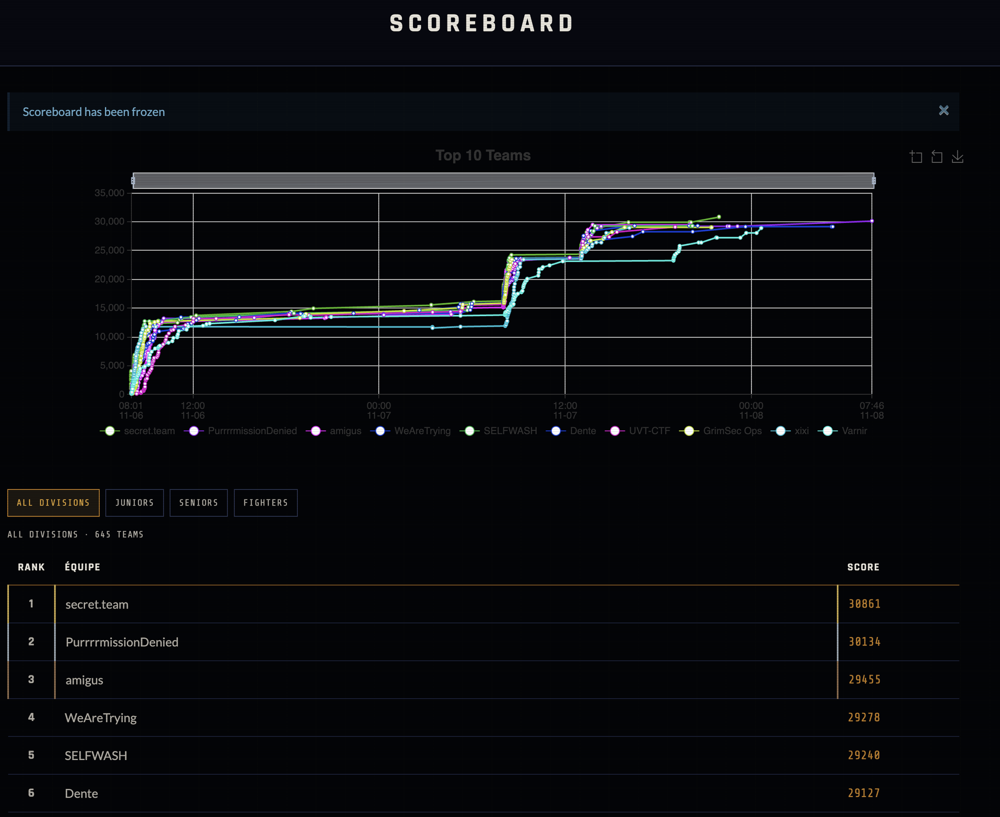

# secret.team at CSCTF 2026: Total Warfare

We finished 1st overall at CSCTF 2026: Total Warfare, out of 645 teams on the scoreboard (1,015 registered), and 1st of 294 in the Fighters division, with 30,861 points and all 108 challenges solved.

CSCTF 2026: Total Warfare was a 48-hour online CTF run by Chronos Security from November 6 to 8, 2026, built around real-world attacks on energy, telecom, healthcare, finance and defense systems. This repo holds a writeup for every challenge.

## The team

| Player | Flags submitted | Points |
|---|---:|---:|
| secretNinja (captain) | 52 | 17,257 |
| [.dev](https://github.com/d0td3v) | 53 | 12,682 |
| [JohnG4lt](https://github.com/j0hn-G4lt) | 3 | 922 |

Points are from our CTFd team page after the event closed.

These numbers only count who submitted each flag, and they don't do JohnG4lt justice. He solved less but contributed more: a lot of his work was fundamental to .dev's solves and to mine.

## How we played

We shared one CTFd team and each kept our own setup, so two separate AI pipelines and one hand-driven web player worked the same board. Both pipelines followed the same idea: deterministic tooling where the work is fast and repetitive, agents where something has to be reasoned out, and a person responsible for direction and judgment calls.

- **secretNinja** used Claude Code as the orchestrator and OpenAI Codex as a second solver pool, on top of a library of offline engines built before the event. A triage router matched each challenge to the engines and playbook worth trying first. Codex did much of the hard tail, including the 31-layer Velora chain.
- **.dev** ran a self-built multi-agent system: a watcher with no model in it that downloaded and triaged every release, a coordinator that gave each challenge one owner, a standby pool of solver agents, and one evidence ledger per challenge. Eighteen flags were accepted in about the first 90 seconds of wave 1.
- **JohnG4lt** worked three web targets by hand, with short purpose-written Python clients to make each exploit exact and repeatable. A lot of his work also went into the solves credited to .dev and me.

The full methodology is at the top of [the team writeup](secret.team-CSCTF2026-writeup.md).

## Results by category

| Category | Solved | secretNinja | .dev | JohnG4lt |
|---|---:|---:|---:|---:|
| [Forensics](writeups/forensics/) | 24 | 5 | 19 | 0 |
| [Web](writeups/web/) | 21 | 14 | 4 | 3 |
| [OSINT](writeups/osint/) | 12 | 3 | 9 | 0 |
| [Reverse engineering](writeups/reverse-engineering/) | 12 | 7 | 5 | 0 |
| [Misc](writeups/misc/) | 11 | 7 | 4 | 0 |
| [Network](writeups/network/) | 9 | 5 | 4 | 0 |
| [Crypto](writeups/crypto/) | 8 | 4 | 4 | 0 |
| [Pwn](writeups/pwn/) | 6 | 6 | 0 | 0 |
| [Welcome](writeups/welcome/) | 2 | 0 | 2 | 0 |
| [ICS](writeups/ics/) | 1 | 0 | 1 | 0 |
| [ML](writeups/ml/) | 1 | 0 | 1 | 0 |
| [Mobile](writeups/mobile/) | 1 | 1 | 0 | 0 |
| **Total** | **108** | **52** | **53** | **3** |

Counts are by who submitted the flag. Several challenges had more than one of us working on them.

## Where to start

These were the highest-value solves on our board:

| Challenge | Category | Points | Submitted by |
|---|---|---:|---|
| [Velora](writeups/web/9125-velora.md) | Web | 898 | secretNinja |
| [Phantom Device](writeups/pwn/9164-phantom-device.md) | Pwn | 875 | secretNinja |
| [Broadsheet Organizer](writeups/web/9165-broadsheet-organizer.md) | Web | 851 | secretNinja |
| [Operation Silent Ward](writeups/network/9159-operation-silent-ward.md) | Network | 821 | .dev |
| [Landfall](writeups/web/9099-landfall.md) | Web | 741 | secretNinja |
| [proprietary](writeups/reverse-engineering/9132-proprietary.md) | Reverse engineering | 711 | secretNinja |

## What's in this repo

- `secret.team-CSCTF2026-writeup.md`: the full team writeup, with our methodology and all 108 challenges in one file.
- `writeups/<category>/`: the same writeups, one file per challenge.
- `screenshots/`: the final scoreboard, and the workflow screenshots referenced in the team writeup.

## Notes

- Flags are included. The event is over.
- Velora ships with JohnG4lt\'s full solver, `writeups/web/9125-velora-solve.py`, and his own walkthrough, `writeups/web/9125-velora-john-writeup.md`.
- Per-team instance hostnames are written as `<instance>`.
- Key Custody, Two-Key Turn and Helioform Relay have no literal flag, because each was read live from a per-team instance and not saved. The answer to Comms Check was a Discord channel topic and is left out on purpose.
- The 30,861 total includes 1,130 points from 48 first-, second- and third-solve bonuses, 31 of them first bloods. Each writeup lists the challenge's CTFd value without the bonus. Three Onion Deanon 2 writeups list 0 points, which is what CTFd showed on our solves page.
- These writeups were drafted by Claude from our notes, solve scripts and logs, then checked against those sources.

## Thanks

Thank you to my teammates, .dev and JohnG4lt, and to Chronos Security and the challenge authors for building and running this event. Congratulations to the other teams at the top of the board.
